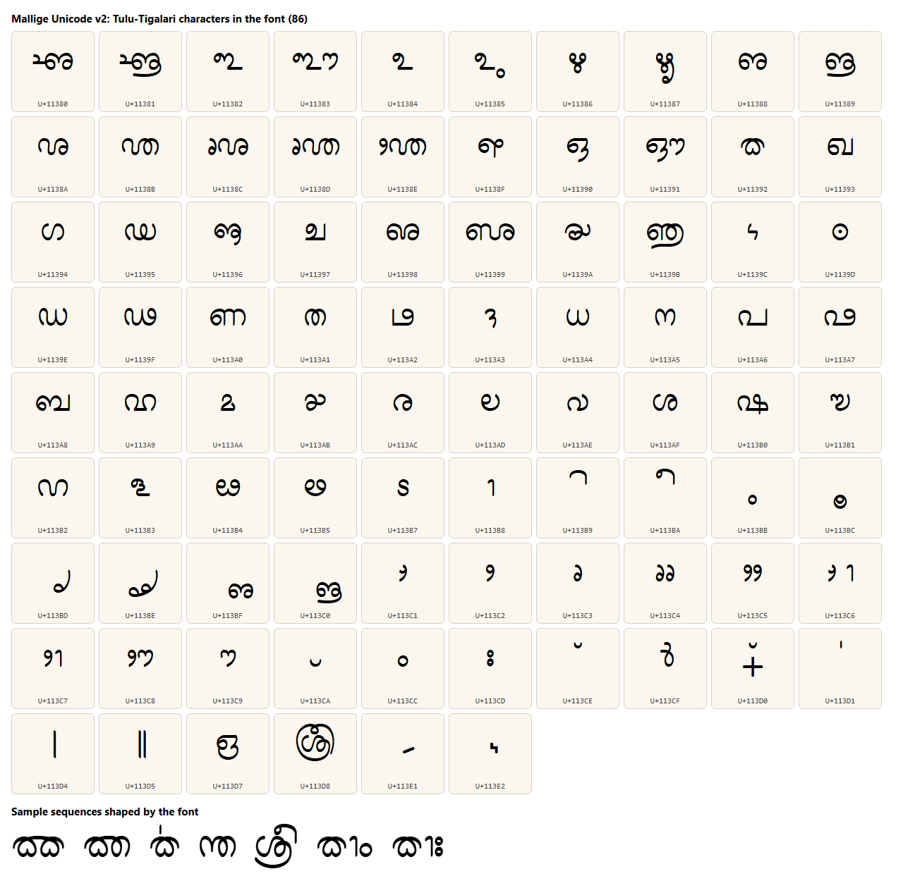

# Mallige Unicode

*Part of the [Tantry Tulu Font Foundry](https://github.com/TantryTuluFonts) · typing standard: [AccTantra](https://github.com/TantryTuluFonts/AccTantra) · keyboard: [AccTantra_Unicode](https://github.com/TantryTuluFonts/AccTantra_Unicode)*

A Unicode font for the **Tulu-Tigalari script** (Unicode 16.0), designed for digital typography, publishing, education and software. Text typed with Mallige Unicode is real Unicode text: it can be searched, copied and shown in any font that supports the script.



## Download

Get the latest font from the [**Releases** page](https://github.com/TantryTuluFonts/Mallige_unicode/releases/latest), or take `Mallige_Unicode_v2.ttf` from this repository.

| File | Version | Notes |
|---|---|---|
| `Mallige_Unicode_v2.ttf` | 1.019 | Current. Use this one. |
| `Mallige_Unicode_v1.ttf` | 1.000 | The first public release, kept for compatibility. |

## At a glance

| Property | Value |
|---|---|
| Font name | Mallige Unicode |
| Style | Regular |
| Current version | 1.019 |
| Glyphs | 2,014 |
| Characters | 181 (86 Tulu-Tigalari, 92 basic Latin, 3 other) |
| Tulu-Tigalari range covered | U+11380 – U+113E2 |
| OpenType scripts | `tutg` (Tulu-Tigalari), `latn`, `DFLT` |
| Layout features | GSUB: `akhn` `blwf` `liga` `rphf` · GPOS: `kern` `mark` `mkmk` |
| Units per em | 1000 |
| Digital signature | `DSIG` table present |
| Designer | Prahlad Prasad Tantry |

### What the OpenType features do

| Feature | Purpose |
|---|---|
| `akhn` | Akhand ligatures |
| `blwf` | Below-base forms |
| `liga` | Standard ligatures |
| `rphf` | Repha forms |
| `mark` | Positions combining marks on their base |
| `mkmk` | Positions marks relative to other marks |
| `kern` | Kerning |

These substitutions build conjuncts and place marks automatically, so you type the characters and the font handles the shaping. The sample sequences at the bottom of the chart above show conjuncts, a repha, anusvara and visarga shaped by the font.

## What changed in v2

Compared with v1 (version 1.000), the current file has:

- 161 more glyphs (2,014 against 1,853)
- 4 more Tulu-Tigalari characters; the range now reaches U+113E2 where v1 stopped at U+113D8
- the `mkmk` feature, and a much larger set of mark-positioning lookups (75 in GPOS, against 5)

## Typing Tulu-Tigalari

Use the **[AccTantra_Unicode](https://github.com/TantryTuluFonts/AccTantra_Unicode)** keyboard (for [Keyman](https://keyman.com)), which follows the AccTantra typing logic and produces real Unicode text for this font.

Need to convert existing text? The [Tulu transliterator](https://prahladtantry.github.io/tulu-transliterator/) converts between AccTantra text and IAST, Devanagari, Kannada or Malayalam.

## Installation

**Windows:** right-click the font file and choose *Install* or *Install for all users*.

**macOS:** open the font file and click *Install Font*.

**Linux:** copy the file to `~/.local/share/fonts/` and run `fc-cache -fv`.

## Rendering requirements

Correct conjuncts and mark positions need an application with OpenType shaping support, such as one built on HarfBuzz, DirectWrite, CoreText or Uniscribe. Without shaping, characters appear but are not joined or positioned.

## Intended uses

Books, dictionaries, academic and educational material, websites, apps, desktop publishing, research on the Tulu language and script, and software that needs a Tulu-Tigalari font.

## Repository contents

```text
Mallige_unicode/
├── Mallige_Unicode_v2.ttf   current font (1.019)
├── Mallige_Unicode_v1.ttf   first release (1.000)
├── OFL.txt                  license
├── README.md
└── specimens/
    └── charset.png          the character chart above
```

## License

Mallige Unicode is licensed under the **SIL Open Font License, Version 1.1**. You may use, study, modify and redistribute it freely, as long as the font is not sold on its own and derivative fonts stay under the same license. The full text is in [OFL.txt](OFL.txt), and a FAQ is at <https://openfontlicense.org>.

Copyright (c) 2022-2026, Prahlad Prasad Tantry.

## Contributing

Bug reports, rendering problems, OpenType improvements and suggestions are welcome through [GitHub Issues](https://github.com/TantryTuluFonts/Mallige_unicode/issues). When reporting a rendering problem, please include the characters you typed, a screenshot, and the application and operating system.

## Citation

If you use Mallige Unicode in academic work, publications or software, please cite this repository.

## Author

**Prahlad Prasad Tantry** · [Tantry Tulu Font Foundry](https://github.com/TantryTuluFonts)
